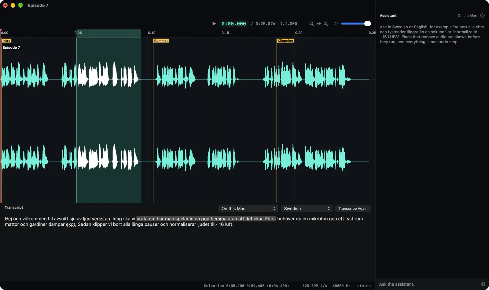

# Getting started

Jämmer is an audio editor for speech, restoration and post-production. This chapter takes you from launch to your first export.

## The first launch

When Jämmer starts, a splash shows a line of text **for your agent**. You only need it if you want an AI agent to work in Jämmer (see [Agents](07-agents.md)). Click **Close** to continue. Untick **Show at launch** if you don't want it every time; **Help › Agent Access** brings it back.

## Open a recording

Choose **File › Open…** (⌘O) and pick an audio file, or drop it on Jämmer's icon. Jämmer opens it as a new, untitled project. Your file is never changed: everything you do is stored in the project and played from the original.

## Listen and look

- Press **Space** to play and stop. Playback starts at the selection, or at the playhead if nothing is selected.
- Click in the ruler (the strip with the times) to move the playhead.
- Scroll to move along the recording, and hold ⌘ or ⌥ while scrolling (or pinch) to zoom.

## Make a first edit

1. Drag across the waveform to select a part.
2. Press **Delete** to remove it. The rest closes up.
3. Choose **Audio › Normalize to −16 LUFS (podcast)** to set the loudness.
4. Press ⌘Z if you change your mind.

## Export

Choose **File › Export Audio…** (⇧⌘E), pick a name, a bit depth and whether to export only the selection, and click **Save**. See [Exporting](06-exporting.md).

## Save the project

**File › Save…** (⌘S) stores the project as a `.jammer` file. It holds your edits, not copies of the audio, so keep the original files where they are.
