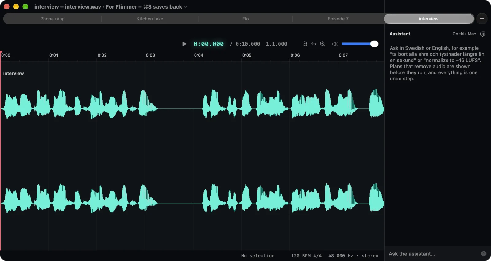

# Documents and files

## Projects

A Jämmer project (`.jammer`) is a small package. Inside is `project.json`, a readable description of the tracks, clips, gains, fades and markers. The audio stays in your original files, which the project refers to by location.

- **File › New** (⌘N) makes an empty project.
- **File › Open…** (⌘O) opens projects and audio files.
- **File › Save…** (⌘S) saves; Jämmer also saves automatically as you work, like other Mac apps.
- **File › Duplicate** (⇧⌘S) makes a copy of the project.
- **File › Revert to Saved** goes back to the last save.
- **File › Collect Audio and Save** copies every file the project plays from into the package (see below).
- **File › Close** (⌘W) closes the window.

If a file the project uses has been moved or deleted, the status bar says how many files are missing, and those clips play as silence.

## Collect audio into the project

**File › Collect Audio and Save** (also in the command palette, ⌘K) makes the project self-contained: every file its clips play from is copied into the package's `Media` folder, and the project plays from those copies from then on. You can then move the `.jammer` file to another disk or Mac, or delete the originals. An untitled project asks where to save first.

- On the same APFS disk a copy is a clone: it's instant and takes no extra space until one of the two files changes. To another disk, it's a full copy.
- Files decoded from MP3, AAC, FLAC and so on are collected too, so the project no longer depends on `~/Library/Application Support/Jammer/Media`.
- Files already in the package, and missing files, are left alone. Collecting again only copies what's new.
- Undo keeps working, and steps from before the collection also play from the copies.

## Audio files

Opening an audio file creates a new untitled project around it. Saving that project asks where to put the `.jammer` file; the audio file itself is never overwritten.

| Format | How Jämmer uses it |
|---|---|
| WAV, including RF64 and BW64 (files over 4 GB) | Played straight from the file |
| AIFF, AIFF-C (uncompressed, little- or big-endian, float) | Played straight from the file |
| MP3, AAC/M4A, FLAC, ALAC, CAF and other formats macOS can read | Decoded once to a 32-bit float WAV in `~/Library/Application Support/Jammer/Media` |

Bit depths from 8 to 32-bit integer and 32/64-bit float are supported.

## Metadata that's kept

Jämmer reads its own way through WAV and AIFF files instead of relying on macOS converters, which drop metadata. It keeps:

- the **Broadcast Wave (bext)** description, originator, date, time and timecode (time reference), coding history and loudness fields,
- **iXML** from field recorders,
- **markers and regions** (WAV cue points and labels, AIFF markers), which appear as markers on the timeline.

When you export from the start of the project, the first file's bext and iXML go with it, and your markers are written as cue points.

## Separately recorded speakers (double-enders)

When each speaker recorded their own side (a "double-ender"), choose **File › Import Tracks…** (⇧⌘I) and pick their files, together with the call recording (Zoom, Riverside, a phone recording) if you have one. Jämmer adds each as a track and lines them up by comparing the sound itself, to the sample. The call recording, where everyone is heard, makes the best reference, and Jämmer picks it by itself: the track that matches all the others best. The status bar says how far each track moved and flags a track without a clear match, which is left where it was. Import and alignment are one undo step.

## Editing a clip for Flimmer

When Flimmer sends a clip's sound to Jämmer ("Edit in Jämmer"), it opens as a linked document: the window says **clip.wav · For Flimmer – ⌘S saves back**. Edit as usual, then **File › Save Back to clip.wav** (⌘S) writes the result into that same file, in the same format, sample rate and bit depth, and Flimmer picks it up. Plugins are included, as in an export. WAV files keep their Broadcast Wave and iXML data and other chunks, and get your markers as cue points; AIFF and FLAC are written by the system's encoder, which keeps the audio but not their own extra metadata.

Jämmer never writes the file by itself: autosave keeps your edits in the document, not in the clip. **File › Save a Jämmer Copy…** (⇧⌘S) saves the whole project, with its edit list and transcript, as a `.jammer` package; ⌘S still saves back to the clip.

If you close the window with changes you haven't saved back, Jämmer asks **Save your changes back to "clip.wav"?** and says how many steps are waiting: **Save Back** writes the file and closes; **Keep for Later** closes the window and keeps the changes in Jämmer; **Discard** gives them up and leaves the file as it was; **Cancel** keeps the document open. It never offers to save a linked document as a new file on its own.

Quitting Jämmer never asks about a linked document. (If another document has unsaved changes, macOS asks about unsaved documents and may count the linked one; whatever you answer there, the linked document's changes are kept.) Changes you haven't saved back are kept, and the document opens again the next time Jämmer starts, with **Kept from last time: not saved back yet** in its title bar. Undo starts from there.

Work that is kept is listed under **File › Linked Files Waiting…**, with the file, the app it is for, how many steps wait and how long ago. **Open** brings it back; **Discard…** asks once, says what is lost, and moves the work to the Trash (the file itself is not touched). Sending the same clip from Flimmer again opens the kept work rather than a fresh copy.

If Jämmer quits unexpectedly while a linked document has changes you haven't saved back, the document comes back the next time Jämmer starts, linked and with the changes, whatever your Mac does with windows when an app quits. The window says **Recovered: not saved back yet** until you save back with ⌘S or close without saving. Jämmer keeps its own record of the document for this, written after every step, so what is lost is at most the step that was being made (and the undo history from before the stop). A linked document without changes doesn't come back on its own; send the clip from Flimmer again and it opens as before.

An ordinary document that you haven't saved is protected by macOS's autosave, which Jämmer asks for a second after every step rather than leaving it to the clock. Tried on one Mac: stopped hard 2 seconds after a change, a document that had never been saved came back with the change when Jämmer started again. What an unexpected stop can cost there is the last second of work.

While the document is open, Jämmer keeps an eye on the clip's file. If the file goes away (the clip was deleted in Flimmer, a disk was unplugged) the title changes to **can't be saved back** within a couple of seconds and ⌘S explains why and offers **Save a Jämmer Copy…**; your edit stays in the window. If the file comes back, the title says **⌘S saves back** again. If Flimmer sends the same clip again while it is open here with changes, the window you already have comes forward with your changes in it, instead of a second one opening.

This works for 16- and 24-bit and 32-bit float WAV, 16- and 24-bit AIFF and FLAC, mono or stereo. Other files from Flimmer open as ordinary new projects.

## A project from someone else

A project names the audio files it plays from, and a project you were sent could name anything. So Jämmer doesn't follow those names blindly:

- **Audio inside the project** (collected with **File › Collect Audio and Save**) is simply used.
- **Audio you have opened yourself** in Jämmer, and audio in projects you saved here, is used as before.
- **Any other file on your Mac** is asked about first: "This project uses audio from outside itself", with the files listed. **Open Without Them** is the safe answer for a project you don't know: those clips stay silent and nothing outside the project is read. **Use These Files** reads them, now and next time.
- **A file is only ever read as the audio it really is.** If a project describes some other file as audio, or lies about what kind of audio a file holds, that file isn't read at all, and the status bar says a file was left out.

A project file that is damaged or cut off is refused with a message; clips that point outside their audio are left out and the status bar says how many.
