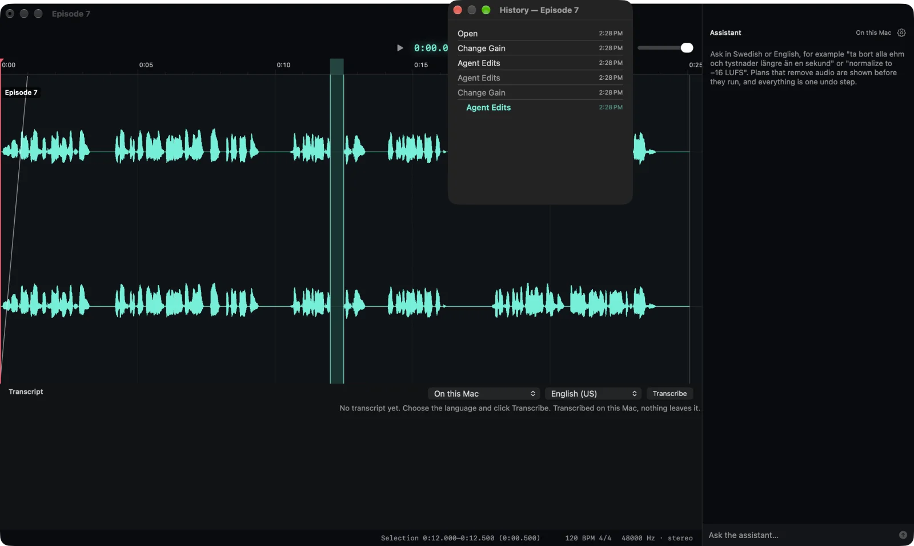

# Editing

Every edit is non-destructive: clips play from your files, and edits change only the project. Every command can be undone with ⌘Z and redone with ⇧⌘Z.

## Cut, copy, paste and delete

| Command | Shortcut | What it does |
|---|---|---|
| **Edit › Cut** | ⌘X | Copies the selection and removes it; what follows moves left |
| **Edit › Copy** | ⌘C | Copies the selection |
| **Edit › Paste** | ⌘V | Inserts what you copied at the selection start (or the playhead) and pushes the rest right |
| **Edit › Delete** | Delete | Removes the selection; what follows moves left |
| **Audio › Silence** | ⇧⌘L | Replaces the selection with silence without moving anything |
| **Audio › Crop to Selection** | ⌘T | Keeps only the selection |
| **Audio › Insert 1 Second of Silence** | | Opens a one-second gap at the playhead |

You can copy in one project and paste in another.

Markers inside a deleted range are removed; markers after it move with the audio.

## Handles and tools

The pointer shows what a press will grab: an I-beam selects, ↔ grabs an edge, an open hand grabs a marker.

| Drag | To |
|---|---|
| A selection's edge | Move that edge |
| A clip's edge, in the lower half of the lane | Trim the clip; the sound under it stays where it is |
| The small square at a clip's top corner | Set the fade in or out; the curve is drawn as you drag |
| A marker's flag | Move the marker (double-click it to rename) |

While you drag, the value shows by the pointer, and edges and markers snap to clip edges, markers and the playhead (a dashed line shows the snap; hold ⌃ to drag freely). Past the window's edge the view keeps scrolling. Esc cancels the drag and puts back what was there. Each drag is one step to undo.

The **tool palette** left of the timeline, **View › Tool**, or a tool's letter while the timeline has the keys picks what a press does:

| Tool | Key | A press or drag in a lane |
|---|---|---|
| Selection | A | Selects, and grabs the handles above |
| Split | S | Splits the clip under the pointer, on that track only |
| Trim | T | Grabs a clip's edges over the whole height of the lane |
| Fade | F | Drags the fade of the clip's nearer end to the pointer |
| Gain | G | Drag up or down to change the clip's gain (1 dB per 4 points) |
| Box, Lasso, Brush | B, L, P | Draw an area in the spectrogram ([Restoration](13-restoration.md)); choosing one shows the spectrogram |
| Zoom | Z | Click to zoom in (⌥-click: out); drag across a range to fill the view with it |
| Hand | H | Drag to move along the timeline |

**Edit › Split at Playhead** (⌘B) splits every track's clip under the playhead. A tool is part of the window, not the project: changing it is never a step to undo.

## Fades

**Audio › Fade In** (⌥⌘I) and **Audio › Fade Out** (⌥⌘O) fade over the selection. A fade in starts at the selection start, a fade out ends at the selection end, and the clip is split there if needed. The curve is equal-power, which sounds even to the ear.

The selection must lie inside one clip per track. If it crosses a clip edge, Jämmer says so and changes nothing; fade each clip separately.

## Gain

**Audio › Gain +1 dB** (⌘]) and **Audio › Gain −1 dB** (⌘[) change the level of the selection, or of everything when nothing is selected. The omnibar (⌘K) also has ±6 dB.

Gain at exactly 0 dB leaves the samples bit-exact.

## Markers

**Transport › Add Marker** (⇧⌘M) adds a marker at the selection start, or at the playhead. Markers appear as yellow flags with their names and are saved in exported WAV files as cue points. **Transport › Previous Marker** and **Next Marker** move the playhead between them.

## Tracks

Click in a track to make it the one the **Track** menu acts on: **Rename Track…**, **Mute** and **Solo** (solo is a way of listening and is never an undo step). The menu also has the loudspeaker **Layout**, the **Mixer…** and **Plugins…**.

## Clips

Every edit that cuts through audio splits it into clips. You see clip edges as thin lines in the lanes. Double-click a clip to select it.

## Echo

The `echo` operation (for agents and sibling apps; a menu entry comes later) adds a feedback echo: `delay` between repeats (0.02–2 s), `feedback` (how much comes back, up to 0.95) and `mix` (how loud the echoes are). The audio in the range is rendered into a new file per track with the echo, so the original stays untouched and one undo removes it. With `tail`, Jämmer makes room after the range so the echoes can ring out.

## History

Undo never throws work away. If you undo a few steps and then do something else, the steps you undid stay in the history as a branch. **View › Show History** (⌥⌘Y) shows the whole tree: the branch you're on is bright, other branches are dim, and clicking any step takes you there. Going to a step is itself one step, so ⌘Z brings you back to where you were.

The history is saved inside the `.jammer` package, so it's still there when you open the project again. It keeps the last 500 steps; when it has to drop some, it drops old side branches first and says so at the top of the History window.
