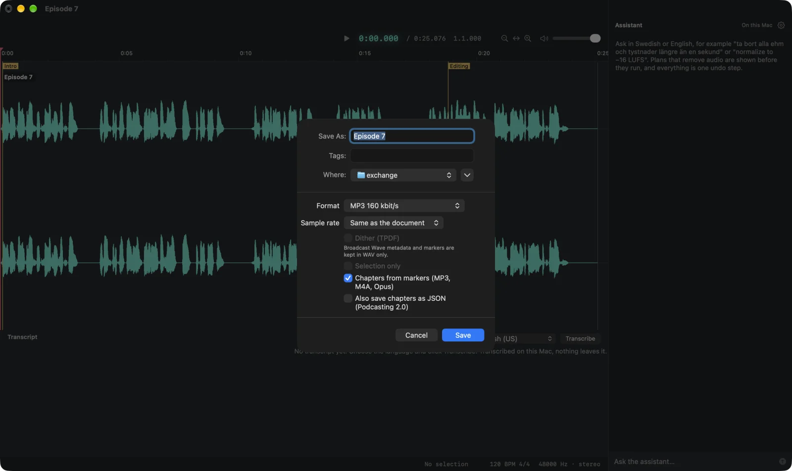

# Exporting

**File › Export Audio…** (⇧⌘E) renders the project to a WAV file.

| Option | Choices |
|---|---|
| Format | WAV 16-bit, WAV 24-bit (default), WAV 32-bit float |
| Dither (TPDF) | Adds triangular dither when writing 16 or 24 bits. Leave it off for bit-exact copies of untouched audio. |
| Selection only | Exports just the selection (on by default when there is one) |

Exports that grow past 4 GB are written as RF64 automatically.

When you export from the start of the project, Jämmer carries over the first source file's Broadcast Wave description, timecode and iXML, adds a line to the coding history, and writes your markers as cue points. The bext loudness fields are left empty rather than copied, since the audio may have changed.

The status bar shows the progress and the file name when it's done.

## Other formats

Besides WAV, **File › Export Audio…** writes **AIFF** (24-bit), **FLAC** (16 or 24-bit), **Apple Lossless** (ALAC, 24-bit, .m4a) **AAC** (192 kbit/s, .m4a) and **Opus** (96 kbit/s, in an Ogg file as podcast hosts expect), with the encoders built into macOS. The lossless formats give back exactly the samples you hear (Jämmer's tests check it). Broadcast Wave metadata, iXML and markers are written in WAV only. **MP3** (160 kbit/s) uses LAME, which ships with Jämmer as a separate library under the LGPL; the file carries the LAME header, so players can trim the encoder's silence and play it gaplessly.

## Loudness of MP3, AAC and Opus

A lossy encoder changes the loudness a little: an MP3 can come out 0.4 LU quieter than the mix it was made from. So when you've just set the loudness with **Audio › Loudness Preset** and export to MP3, AAC or Opus, Jämmer reads the finished file back, measures it, corrects the level going into the encoder and encodes again (at most twice more), without letting the peaks pass the preset's ceiling. The status bar then says what the file measures, for example "Exported Episode 7.mp3 at −16.0 LUFS (+0.44 dB to make up for the encoder)".

This only happens while the document is as the preset left it. Edit anything afterwards and the export is a plain one again; apply the preset once more when you're done. WAV, AIFF, FLAC and Apple Lossless keep the mix exactly, so there is nothing to correct.

## Chapters

Markers are chapters. Each marker starts a chapter that runs to the next marker (or the end). **MP3** gets ID3 chapter frames, **AAC and ALAC** (.m4a) a chapter track like the ones Apple Podcasts and QuickTime show, and **Opus** CHAPTER comments, which ffmpeg-based players read; if the first marker comes after the start, a chapter called "Start" covers the beginning. **Also save chapters as JSON** writes the same chapters as a Podcasting 2.0 chapters file (`name.chapters.json`) next to the audio, for hosts that take a separate file. WAV keeps markers as cue points, as before; AIFF and FLAC get no chapters.
