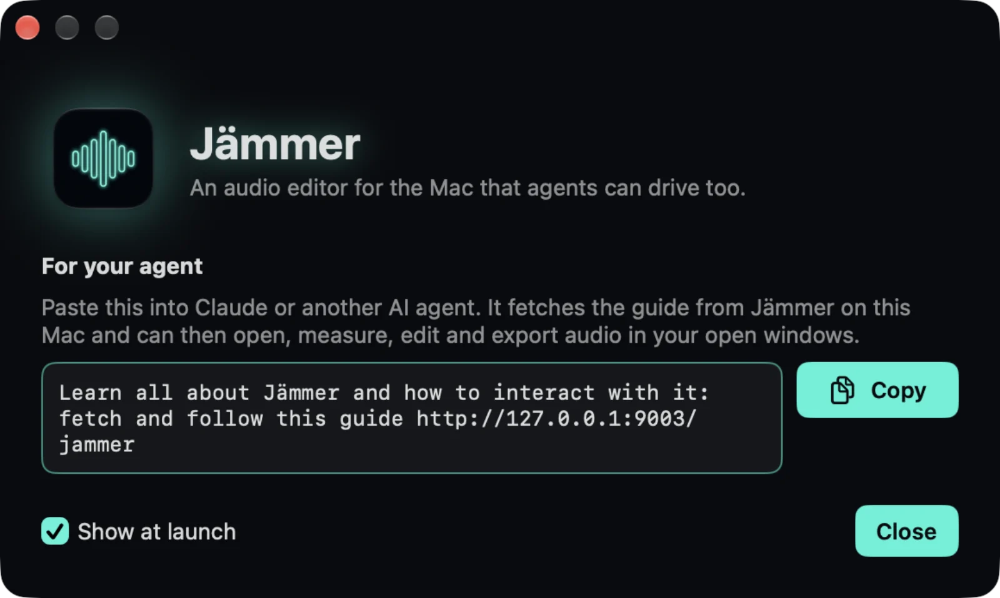

# Agents

Jämmer serves a guide and a small HTTP API on your Mac, so an AI agent such as Claude can open, measure, edit and export audio in your open windows.

## Connect an agent

1. Open the splash (it appears at launch, or choose **Help › Agent Access…**).
2. Under **For your agent**, click **Copy** (⇧⌘C).
3. Paste the line into your agent. It looks like this:

   `Learn all about Jämmer and how to interact with it: fetch and follow this guide http://127.0.0.1:9003/jammer`

The agent fetches the guide and follows it. **Help › Open the Agent Guide** shows the same guide in your browser.

## Bring your own agent

Any agent that can fetch a web page and make HTTP requests on your Mac can work in Jämmer this way: Claude Code, Codex, or another one you run yourself in a terminal or an app. You start the agent and sign in to it as you always do; Jämmer doesn't start it, doesn't see its login, and doesn't pay for it. The line above is all the set-up there is.

This is separate from the built-in assistant in the editor's side panel (see [The assistant](14-assistant.md)), which makes a plan for one request with a model you choose there.

## What an agent can do

- Open audio you or it provides (as bytes; the API never reads file paths).
- Read the document: tracks, clips, markers, tempo map, selection and playhead.
- Measure loudness and look at the waveform.
- Edit with the same operations as the menus, including setting the tempo. One request is one undo step that you can undo with ⌘Z; a request that fails changes nothing.
- Export the result.
- Start and stop playback, but only in a window you can see.

An agent can never start recording.

## Safety

- The API listens only on your Mac (127.0.0.1). Other computers can't reach it.
- Web pages can't use it: requests that come from a browser page are refused, and every change needs a special header.
- Nothing in Jämmer costs money today. If paid features are added, an agent must explicitly allow them per request.

## The port

Jämmer uses port 9003 when it's free, otherwise the first free port from 9301 to 9319. The splash always shows the address in use. Glimmer and Flimmer use their own ports, so all three can run at once.

The full API is described in the [agent guide](../agents.md).

## Glimmer and Flimmer

Jämmer's sibling apps can ask it for things through the same local API, for example Flimmer's Copilot: "turn up the volume and add an echo to this clip". Flimmer sends the clip's audio to Jämmer, the steps run in a Jämmer window you can see (one undo step, the status bar says "Requested by Flimmer"), and Flimmer gets the result back as a new take. The document stays open in Jämmer so you can carry on by hand.

What siblings can ask Jämmer for: every operation in its list (cut, gain, normalize, fades, echo, removing words, and the rest), plus measuring loudness, transcribing and repairing audio. They can't start recording, delete your files or change settings, and asking gives them no rights an agent wouldn't have.
