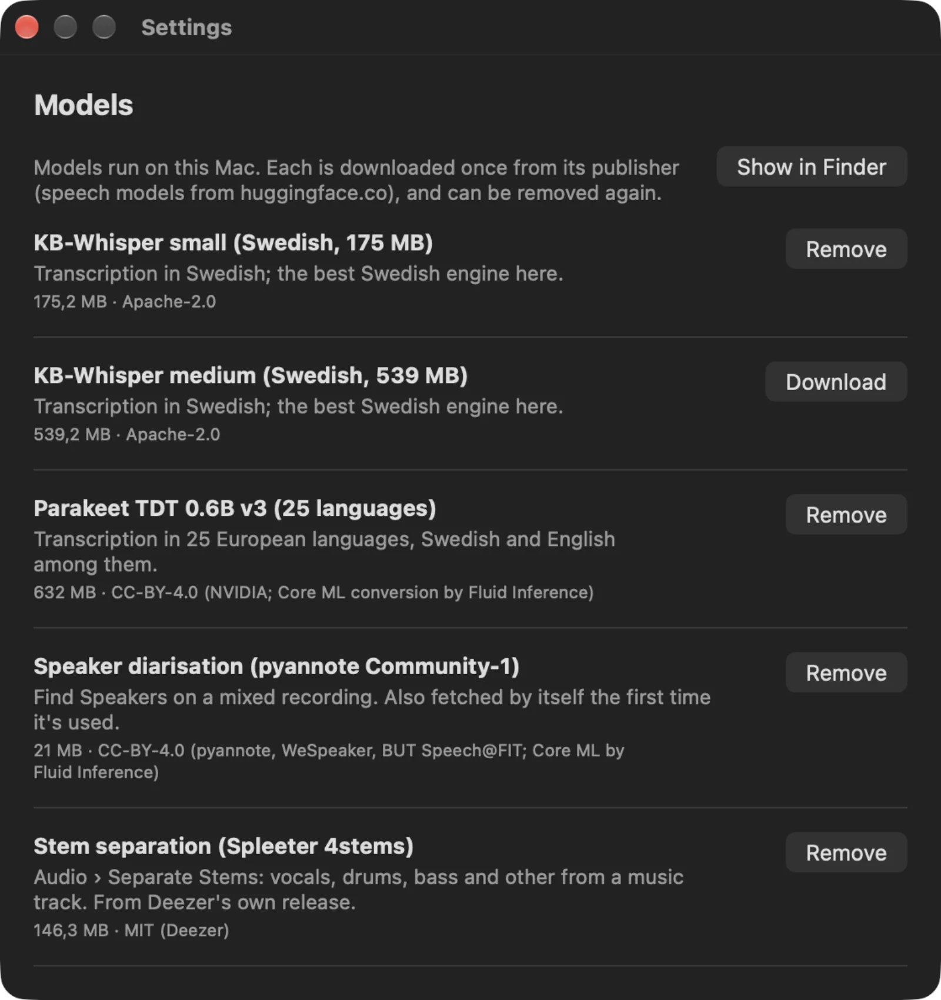

# Settings

**Jämmer › Settings…** (⌘,) has two tabs: **Models** (below) and **Agents**. A few other choices are remembered where you make them:

| Setting | Where | What it does |
|---|---|---|
| Show at launch | The splash (Help › Agent Access…) | Whether the splash appears when Jämmer starts |
| Playback volume | The slider in the transport bar | How loud Jämmer plays. It doesn't affect exports or measurements. |
| Transcription language | The menu in the transcript panel | The language Transcribe uses |
| Assistant model | The gear in the assistant panel | The model on this Mac, a model in Ollama on this Mac, or your own model and key at OpenRouter, Berget or Grunden |
| Safe mode for plugins | Track › Plugins… | Runs every Audio Unit in macOS's separate plugin host process instead of inside Jämmer |

Window size and position are remembered too.

## Agents

**Folders agents may use**: an agent normally works only on the documents you have open. Batch processing reads and writes files by path, and an agent can do that only inside the folders listed here. Add one with **Add Folder…**; remove it to take the permission back. The list starts empty. Batches you start yourself from File › Batch… don't need it.

**Let other apps use Jämmer's transcription** (on unless you turn it off): apps on this Mac, such as Drömmer, can send short turns of speech, up to 15 seconds each, or a whole file of up to 2 hours (such as the sound of a film), to be transcribed with Jämmer's local models. Nothing is kept or logged, neither the sound nor the text: a file lies in a temporary folder only while it is transcribed, and the words are forgotten once the app has fetched them. While it works every open Jämmer window says "Transcribing for Drömmer…" (or "Transcribing a file for Drömmer…" with how far it has come) in its status bar, with a button that stops it.

## Models

**Jämmer › Settings… › Models** (⌘,) lists the speech models Jämmer can use. Each shows what it's for, its download size and its license, and each can be removed again. **Download** first shows a sheet with the size, the publisher, the exact source and version, the license and where it will be kept; nothing is fetched until you click Download there. While it downloads, **Stop** next to the progress bar stops it. Jämmer checks every file it downloads against the checksum its source publishes, and if a single file doesn't match, nothing is installed and the error is shown:

- **KB-Whisper** small or medium: the most accurate Swedish transcription (Apache-2.0).
- **Parakeet TDT 0.6B v3**: transcription in 25 European languages, Swedish and English among them, very fast (CC-BY-4.0; about 630 MB).
- **Stem separation** (Spleeter 4stems): vocals, drums, bass and other from a music track (MIT; 146 MB; from Deezer's own release).
- **Soundtrack separation** (MRX): speech, music and effects from film or video sound (MIT; 122 MB; from MERL's own repository).
- **Speaker diarisation**: for Find Speakers on a mixed recording (CC-BY-4.0; about 22 MB). Find Speakers offers to download it the first time.
- **Klang Pianissimo** Swedish or Danish (Klang AI AB, from NVIDIA Parakeet; CC-BY-4.0; about 690 MB and 630 MB): transcription with word timings on this Mac.
- **Whisper small, multilingual** (OpenAI, whisper.cpp's conversion; MIT; 190 MB): for transcribing each voice track in its own language.

When you transcribe, Jämmer picks KB-Whisper for Swedish if it's installed, otherwise Parakeet if it's installed and knows the language, otherwise the Mac's own recognizer, which needs no download. Agents can ask for a particular engine but can't download models; that's up to you.
