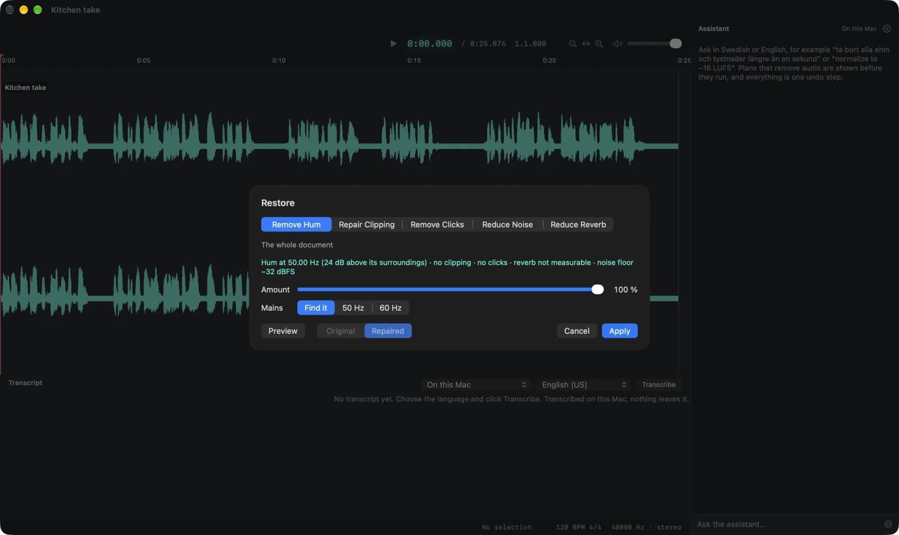
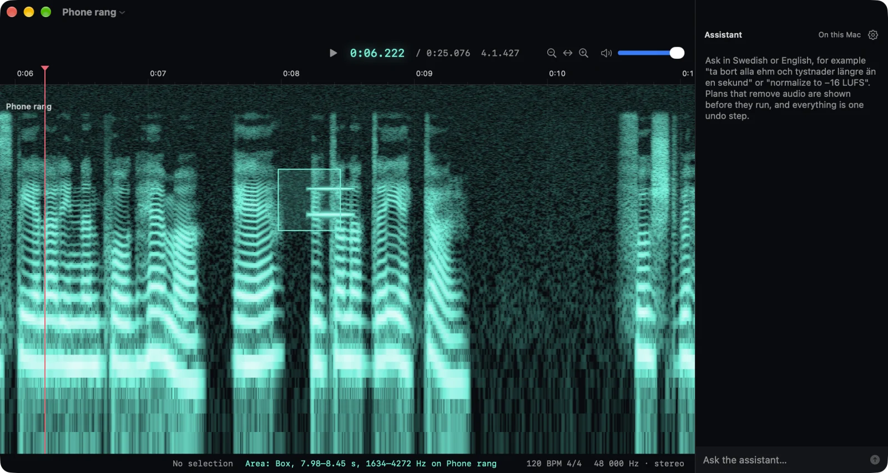

# Restoration

**Audio › Remove Hum…, Repair Clipping…, Remove Clicks…, Reduce Noise…, Reduce Reverb…** (also in the omnibar, ⌘K) open the Restore sheet. It works on the selection, or on the whole document when nothing is selected.

## The repairs

| Repair | What it does |
|---|---|
| **Remove Hum** | Finds mains hum at 50 or 60 Hz (to a few thousandths of a hertz) and removes it and its harmonics with narrow notch filters. Speech and music around it are left alone. Choose 50 or 60 Hz yourself if it doesn't find the hum. |
| **Repair Clipping** | Finds samples flattened at the top of the range and rebuilds the wave from the audio around them. |
| **Remove Clicks** | Finds short clicks and pops and fills them in from the surrounding audio. Raise the sensitivity to catch quieter clicks. |
| **Reduce Noise** | Takes down steady background noise (hiss, fans, room tone) under speech with DeepFilterNet 3, a small model that ships with Jämmer and runs on your Mac. Amount sets how far the noise is lowered; start around half and listen. |
| **Reduce Reverb** | Takes down the room: the echo that hangs on after each word in a bare or large room. It works out from the recording itself how each sound keeps ringing and removes that part, leaving the direct sound (no model, nothing to download). Amount starts at 70 %; all the way can sound unnaturally dry. It doesn't remove noise, and on a recording that's already dry it changes next to nothing. |

When the sheet opens, Jämmer looks at the audio and tells you what it found, for example "Hum at 50.00 Hz · no clipping · 4 clicks · reverb about 0.6 s · noise floor −58 dBFS".

- **Clicks** are impulses a few samples long that stand out from the sound around them. A voice's own pulses and the attack of a note aren't counted; in dense music only clicks well above the music are found.
- **The reverb figure** is roughly how long a sound takes to die away; under 0.3 s there is little to gain from Reduce Reverb. After Remove Hum or Reduce Noise it reads "reverb not measurable after noise or hum removal": what those repairs leave after each word looks like a room to the measurement, so Jämmer doesn't give a number it can't stand behind. Look at the reverb before you remove hum or noise.
- **The noise floor** is the level in the pauses (plain RMS in dBFS, so it doesn't compare with LUFS). Compare it before and after a repair to see what the repair did. It is left out when there are no pauses of 150 ms or more to measure in, and when the pauses are digital silence.

## Amount and preview

**Amount** blends between the original (0 %) and the full repair (100 %). **Preview** plays up to 30 seconds from the selection (or the playhead) with the repair; switch between **Original** and **Repaired** while it plays to compare. Nothing changes until you click **Apply**.

## What Apply does

The repaired clips play from a new file that Jämmer writes in `~/Library/Application Support/Jammer/Media` (use **File › Collect Audio and Save** to move it into the project). Your original file is never changed, and one **Undo** brings back the unrepaired audio. Transcripts stay with the repaired clips. The status bar shows the progress; you can keep working meanwhile.

## Drawing in the spectrogram

In the spectrogram (**View › Show Spectrogram**) you can mark a sound by where it is in time *and* pitch, and change only that. Pick a tool with **B** (box), **L** (lasso) or **P** (brush), then drag over the sound on its track; the area shows in turquoise and the status bar describes it ("Box, 1.42–1.59 s, 66–210 Hz"). Esc clears it.

- **Audio › Heal Area** rebuilds the area from the sound just before and after it. It's for short sounds (a click, a cough, a phone ringing, up to half a second); longer areas are refused, use attenuate for those.
- **Audio › Attenuate Area…** lowers the area by the amount you choose.
- **Audio › Edit Spectrum Numerically…** does the same with a box you type in (time in seconds, frequency in Hz) on a track you pick, for when drawing isn't practical.

As with the other repairs, the changed stretch plays from a new file; the original stays untouched and one undo brings it back, and the transcript and speakers stay as they were.
