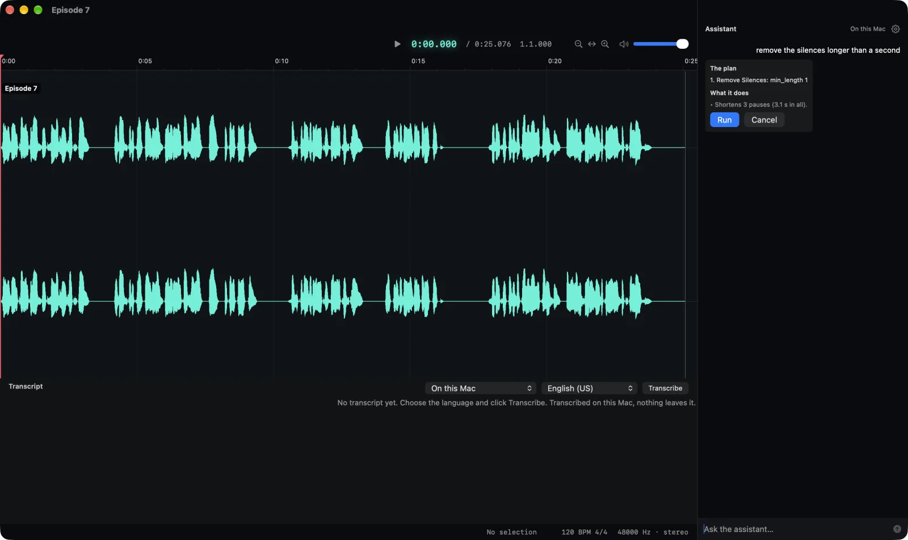

# The assistant

Ask Jämmer in Swedish or English and it does the editing: "ta bort alla ehm och tystnader längre än en sekund", "normalize to −16 LUFS", "ta bort brummet på talare 2", "fade in the first two seconds".

## Open it

**View › Show Assistant** (⌥⌘A), or **Ask the Assistant…** in the command palette (⌘K). The chat opens beside the timeline; type a request and press Return.

## What happens

- The assistant turns your request into a plan of Jämmer's own commands: the same ones as the menus and the agent API, so it can only do what Jämmer can do.
- A plan that removes or replaces audio (deleting, cutting, removing filler words or pauses, repairs, echo) is shown first, with **Run** and **Cancel**. Other plans, such as changing the level or measuring loudness, run straight away.
- Under **What it does**, Jämmer says in numbers what the plan will do, worked out from the steps themselves rather than from the assistant's words: "Deletes 2.0 s of 3:12 at the end", "Removes 14 words (6.2 s)". If a plan would remove more than a fifth of the document, or deletes audio although you didn't ask to remove anything, it's outlined in orange with a warning, and Return cancels instead of running.
- All the editing in a plan is **one undo step**. Transcribing and repairs run as their own steps in between (they take a moment; the status bar shows the progress).
- Removing filler words needs a transcript; the assistant transcribes first if there isn't one.
- Questions like "how loud is it?" are answered in the chat.

## Which model

Click the gear in the assistant's header.

| Choice | What it means |
|---|---|
| **On this Mac** (default) | Apple's on-device model. Free, private, works offline; nothing leaves the Mac. Understands Swedish and English (and Danish, Norwegian, German and more). |
| **Ollama on this Mac** | A model you have installed in [Ollama](https://ollama.com), when Ollama is running. Free and private: nothing leaves the Mac, and Jämmer never downloads a model. Only models that can call tools are listed. It is slower than the on-device model (about 8 seconds a request in our test) and the model takes about 6 GB of memory while it runs. Tried with `qwen3:8b` on one Mac, where it picked the right actions at least as often as the on-device model; other models are marked "not evaluated with Jämmer", and you can evaluate one yourself with `scripts/eval-assistant.sh` from the source. |
| **OpenRouter**, **Berget**, **Grunden** | A model of your choice at one of these services, with your own key. The key is kept in your Keychain, one per service. The models and their prices are read from the service's own list; a model that can't call tools is marked and can't be used. Every request asks first and shows the approximate price; only your request and a short description of the document (length, tracks, the start of the transcript) are sent, never the audio. Berget and Grunden run in Sweden by their own account. They are built from their documentation and haven't yet been tried with a paid request, so if one of them answers with an error, Jämmer shows the error as it came. |

## Good to know

- Speakers are tracks: "talare 2" or "track 2" means the second track.
- If a request is unclear, the assistant asks instead of guessing.
- How well the on-device model picks the right commands was measured on a fixed set of requests; see the project's `docs/ASSISTANT.md`. It's good at single tasks; with several tasks in one sentence it sometimes does only one, so check the plan, or ask for one thing at a time.
