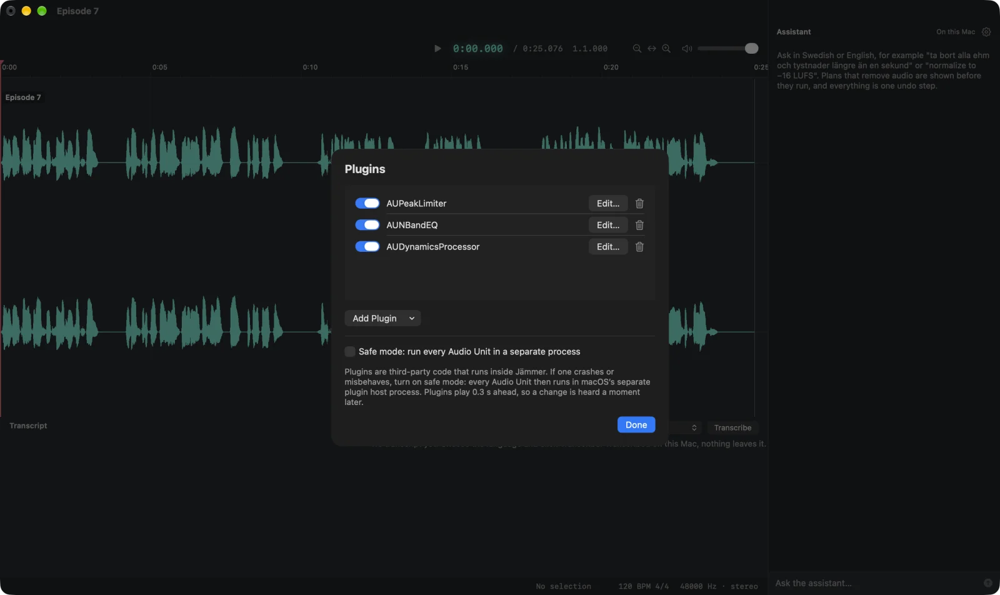

# Plugins

A track can run through Audio Unit effects (AUv2 and AUv3) after its clips and before its gain: an EQ, a compressor, a de-esser, a limiter.

## Add one

**Track › Plugins…** (⌥⇧⌘P) opens a window of its own beside the document's, on the selected track; the Space bar still plays while it is open. In [the mixer](20-mixer.md), each strip lists its plugins in their order (a bypassed one says so), and its **Plugins…** button opens the same window on that strip. Pick the track (or a bus, when the document has any), then **Add Plugin** and the effect, grouped by manufacturer. Each plugin in the list has:

- a switch to turn it **on or off** (off is bypass: the track sounds exactly as without it),
- **Edit…**, which opens the plugin's own window (or sliders for its parameters when it has no window),
- the bin, to take it off.

Plugins run in the order listed; drag one up or down the list to change its place (with VoiceOver, its Move Up and Move Down actions). Each one is one undo step, and so is a change made in a plugin's window: Jämmer stores the plugin's settings in the document shortly after you stop turning a knob, and when you close the window.

## What they affect

- **Playback.** Jämmer renders a third of a second ahead, so a change in a plugin's window is heard a moment later.
- **Exports and loudness.** Exports, **Measure Loudness**, **Normalize** and the loudness presets all hear the plugins, so "compress, then normalize to −16 LUFS" works as you'd expect.
- **Timing.** Each plugin's latency (for example a limiter's look-ahead) is compensated, so a track with plugins stays in time with the others. The same goes for plugins on a bus.
- **Not** the repairs, echo, spectral attenuation or drift correction: these work on the recorded audio before the plugins, and the plugins then process their result.

The original files are never touched; taking a plugin off brings the track back exactly.

## Plugins are someone else's code

A plugin runs inside Jämmer, and a badly behaved one can crash the app. If that happens, turn on **Safe mode** at the bottom of **Track › Plugins…**: every Audio Unit then runs in macOS's separate plugin host process instead, which is meant to keep one that crashes from taking Jämmer with it.

A plugin that isn't installed on this Mac (a document from another computer) is listed with a warning and passes the audio through unchanged; its settings stay in the document for when it's back.

## For agents

The agent API can list the installed plugins, add and remove them, set parameters and bypass, and read a plugin's parameters with their ranges. It can't open plugin windows. See [the guide](../agents.md#plugins).

## A project from someone else with plugin settings

A project saves each plugin's settings, and settings are data that the plugin reads. Settings made in your own Jämmer are simply loaded. When a project brings settings that weren't made here (a project someone sent you, or your own from another Mac), Jämmer asks first: "This project wants to load settings into …", with the plugins listed.

- **Open Without Them** is the safe answer for a project you don't know: those plugins aren't started, and their tracks play without them. Nothing in the project is changed.
- **Load in Separate Processes** starts the plugins with the project's settings, each in a process of its own, so a plugin that misreads them can't take Jämmer down with it. It costs a little more of the computer. Jämmer doesn't ask about those settings again, and a plugin that started this way stays in its own process, also with the settings it makes afterwards. The question names each plugin's kind and maker.

