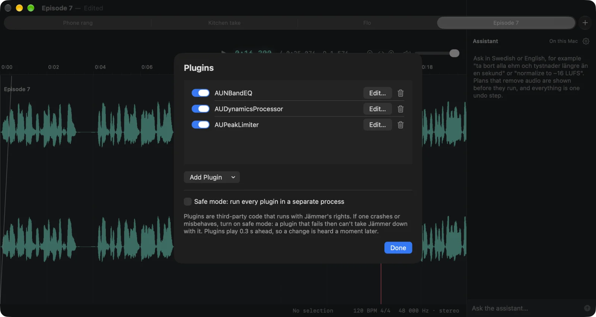

# Plugins

A track can run through effects after its clips and before its gain: an EQ, a compressor, a de-esser, a limiter. Jämmer takes Audio Units (AUv2 and AUv3) and CLAP plugins.

## Add one

**Audio › Plugins…** (⌥⇧⌘P). Pick the track, then **Add Plugin** and the effect, grouped by manufacturer. Each plugin in the list has:

- a switch to turn it **on or off** (off is bypass: the track sounds exactly as without it),
- **Edit…**, which opens the plugin's own window. A CLAP plugin, and an Audio Unit without a window, gets sliders for its parameters instead,
- the bin, to take it off.

Plugins run in the order listed. Each one is one undo step, and so is a change made in a plugin's window: Jämmer stores the plugin's settings in the document shortly after you stop turning a knob, and when you close the window.

## What they affect

- **Playback.** Jämmer renders a third of a second ahead, so a change in a plugin's window is heard a moment later.
- **Exports and loudness.** Exports, **Measure Loudness**, **Normalize** and the loudness presets all hear the plugins, so "compress, then normalise to −16 LUFS" works as you'd expect.
- **Timing.** Each plugin's latency (for example a limiter's look-ahead) is compensated, so a track with plugins stays in time with the others.
- **Not** the repairs, echo, spectral attenuation or drift correction: these work on the recorded audio before the plugins, and the plugins then process their result.

The original files are never touched; taking a plugin off brings the track back exactly.

## Plugins are someone else's code

**CLAP plugins never run inside Jämmer.** Each one runs in a small helper program of its own, which can't reach the network, can't write files and, of your files, can read only the plugin folders. If a CLAP plugin crashes or stops answering:

- the track plays on without it, still in time with the others,
- the status bar tells you which plugin it was,
- the plugin is switched off, so it isn't started again by accident. **Audio › Plugins…** lists it with a **Switch On** button for when you want to try again,
- your document is untouched.

Jämmer finds CLAP plugins in `~/Library/Audio/Plug-Ins/CLAP` and `/Library/Audio/Plug-Ins/CLAP` when it starts; **Scan for CLAP Plugins** looks again. Each plugin is looked at in a helper program too, so one that crashes or hangs while it's loaded is just listed as unusable. At most 64 CLAP plugins run at the same time.

Because of the confinement, a CLAP plugin that needs to read its own licence or preset files from elsewhere on your disk, or to go online, may not work here.

**Audio Units run inside Jämmer**, and a badly behaved one can crash the app. If that happens, turn on **Safe mode** at the bottom of **Audio › Plugins…**: every Audio Unit then runs in macOS's separate plugin host process instead, which is meant to keep one that crashes from taking Jämmer with it.

A plugin that isn't installed on this Mac (a document from another computer) is listed with a warning and passes the audio through unchanged; its settings stay in the document for when it's back.

## For agents

The agent API can list the installed plugins, add and remove them, set parameters and bypass, and read a plugin's parameters with their ranges. It can't open plugin windows. See [the guide](../agents.md#plugins).
