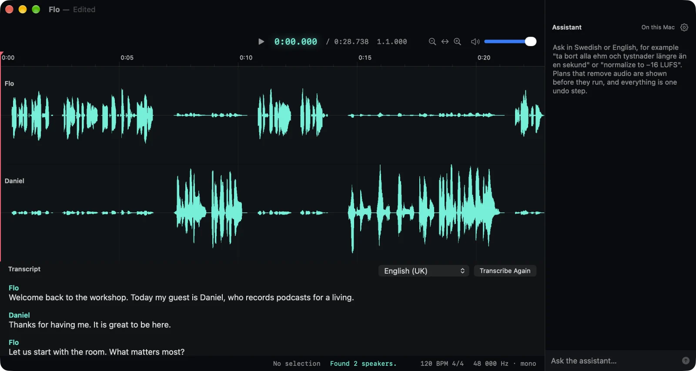
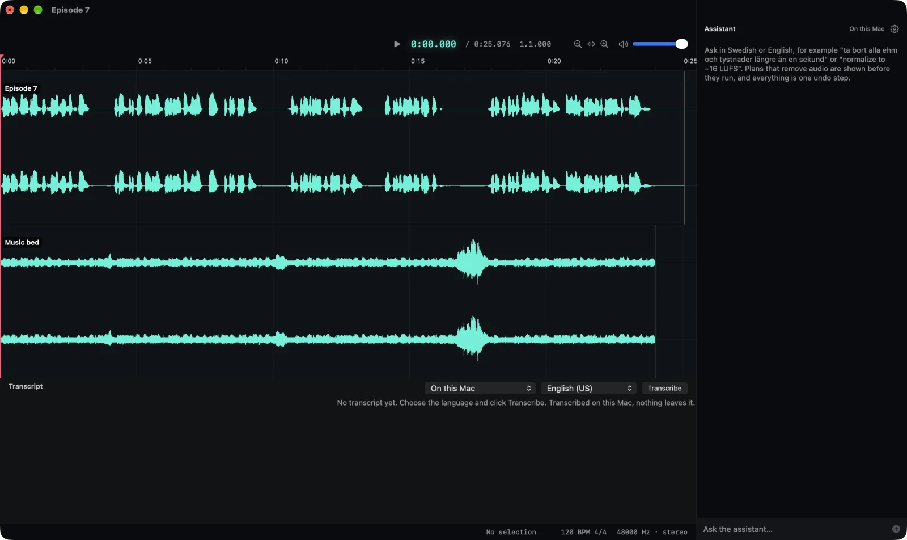

# Speakers

**Audio › Find Speakers › Automatically** works out who speaks when. The transcript then starts a new paragraph with the speaker's name each time someone else talks, and agents can ask who said what.

## Two ways

- **One person per track** (a double-ender, where each person recorded themselves): Jämmer treats each track as its speaker and names them after the tracks. It counts speech only where a track is clearly louder than the other voices bleeding into its microphone, so a laugh from the other side doesn't count, and real overlaps count for both. This is what Find Speakers does whenever several tracks play at the same time.
- **Everyone on one track**: a speaker-recognition model listens to each track and tells the voices apart. The first time, it downloads the model (about 20 MB) from Hugging Face; after that it works offline.

**Which to use:** for a double-ender, one track per person is the better way by far: it's exact and needs no model. The model is for a mixed recording, where everyone is on the same track.

The model does very well with voices that sound different and take turns of a few seconds. It struggles with voices that sound alike in quick back-and-forth ("ja", "precis", "mm"): in our test with two similar women's voices it heard only one speaker. When you know how many people talk, choose **Audio › Find Speakers › 2 Speakers** (or 3, 4); that helps a lot. If the model finds only one speaker, Jämmer says so in the status bar and suggests exactly that, rather than presenting one speaker as the answer.

## Names

The model calls them Speaker 1, Speaker 2 and so on; agents can rename them (`rename_speaker`). Speakers found on different tracks are kept apart even if they're the same person; give them the same name to pair them up.

## Edits and undo

Finding speakers is one undo step. Like transcript words, speaker turns belong to the recorded audio, so they stay right while you cut, move and delete. Run Find Speakers again to start over; it replaces the speakers on the tracks it looks at.

## Level the speakers

**Audio › Level Speakers › One Gain per Speaker** brings everyone to the same loudness (−18 LUFS each by default), measured over their own turns, with one gain per person, so a quiet guest and a loud host end up even. On a double-ender each track simply gets its gain; when people share a track, Jämmer cuts the clips in the pauses where the speaker changes and sets each piece's gain (where two people talk at once, the lower gain wins, so nobody is pushed on top of the other). Nothing is moved and the transcript stays as it was. It needs speakers first (Find Speakers), changes each speaker by at most 12 dB, and is one undo step; afterwards a loudness preset sets the whole mix for the platform.

## Remove bleed

On a multitrack recording each microphone also hears the others. **Audio › Remove Bleed** has two ways to take that out, for two different situations:

- **Several people in the same room**, each with their own microphone: every mic picks up the others a few milliseconds late. **Gate Each Track Outside Its Speaker** turns each track down (18 dB by default, with soft 20 ms edges) whenever its own speaker isn't talking; their own speech isn't touched at all. It needs speakers found one per track first (Find Speakers on the multitrack recording). This is the best choice whenever people don't talk over each other.
- **A remote interview** (a double-ender): there's no acoustic bleed between the places, but the other person's voice can leak out of your guest's headphones or speakers into their microphone, coming back 50–500 ms late and sounding like a phone line. **Cancel the Other Tracks' Leak** finds that delay by itself (up to a second), learns what the leak sounds like where the track's own speaker is quiet, and subtracts it everywhere, so it also works while both talk at once. Their own voice is kept.

In our tests gate lowered the bleed by more than 15 dB and cancel by 16 dB (remote, 180 ms late) to 29 dB (same room), with the speakers' own voices unchanged. Both are one undo step; the processed tracks play from new files and the originals stay as they were.

**Ride Each Speaker's Level** goes further: when one person drifts (leans back from the mic, gets tired, gets excited), it follows them over time, measuring their loudness over a few seconds of their own speech and nudging it back to the target. Because Jämmer has the whole recording, it looks ahead: a sentence that starts louder after a long pause is already at the right level from its first word, and pauses are never turned up, so the background doesn't swell in the silences. The rhythm within a sentence is kept. In our test a speaker who dropped 8 dB halfway through came out within 0.2 LU of the target in both halves. The levelled tracks play from new files; the originals stay, one undo away.

## Music under speech (ducking)

**Audio › Duck Under Speech…** lowers music or atmosphere while someone is speaking and lets it come up in the pauses. Tick the tracks to lower; the tracks you leave unticked decide when. (When there's a transcript, Jämmer ticks its guess for you, but check it: a transcription finds "words" in music too.)

- The ticked tracks go down **12 dB**. They start going down just before the first word (so the word isn't drowned), stay down through pauses shorter than 0.4 s (so the music doesn't pump between sentences), and come back up over 0.6 s.
- Where the speech is comes from the **speakers' turns** when you've found the speakers on those tracks, and otherwise from how loud the tracks are.
- Each ducked track plays from a **new file**. Outside the lowered stretches it is the same sound, sample for sample, and **Undo** brings the old sound back.
- It isn't live. If you move or cut the speech afterwards, duck again: on a track that hasn't been edited since, the new ducking **replaces** the old one rather than adding to it.

An agent can set the amount, the times and the threshold, and limit it to a range (the `duck` step).

Tried on synthetic material with speech at known times (the level under the speech is the amount to within 0.1 dB, the ramps are the lengths asked for, and nothing outside them changes) and in the app on a spoken podcast intro with music under it.

## One track per speaker

**Audio › Split Speakers onto Tracks** gives each speaker found on a track a track of their own, named after them. Together the new tracks play exactly what the track did: where two people talk at once, that moment goes to the one whose turn is longer, and a pause between two people is split in the middle. The original track is muted and kept. It is one undo step, and no file is changed.

## Voice profiles

A voice profile lets Jämmer recognize a voice it has heard before. When it finds the speakers in a new recording, a speaker whose voice is like a saved profile is named after it.

- **Saving one.** Find the speakers first, then choose **Audio › Find Speakers › Save Speaker as Voice Profile…**. Pick the speaker, give the profile a name, and say whose voice it is: your own, or someone who knows about it and has agreed that their voice is saved for recognition. Nothing is saved before that.
- **What is saved.** A voiceprint: numbers the speaker model works out from the voice, not the recording. It is biometric data. It is kept only on this Mac, in `~/Library/Application Support/Jammer/VoiceProfiles`, one file per profile, and Time Machine may have copies. It never goes into a document, an export, Send to Flimmer or to an agent.
- **A suggestion, not a fact.** A speaker named after a profile was found to be *like* it. The status bar says how alike (0 to 1), the step is its own undo step, and a name you set yourself is never replaced. Each profile names one speaker at most in a document.
- **Deleting and switching off.** **Jämmer › Settings… › Voice Profiles** lists the profiles with their dates. Deleting one removes its voiceprint from the Mac for good; documents that already have the name keep it, as it is their content. Recognition can be switched off there too.

**How well it recognizes, measured before it was shown.** The likeness a speaker needs is 0.60. On 40 real readers (LibriSpeech, read speech), a profile made from one chapter was tried against another chapter by the same reader and by every other reader, clean and with noise, a phone line and a room added: no other reader was taken for the profile's owner in 4,680 tries in any condition. The owner was missed 4 % of the time on clean speech, 6 % in a room, 13 % with noise and 19 % over a phone line. Among 8 synthetic voices one pair from the same speech engine was taken for each other. Profiles made from a clean recording work best.

**For agents.** `GET /api/v1/voice-profiles` lists the profiles (id, name, date), never the voiceprints. `POST …/voice-profile/request` shows the saving sheet in a visible window; the user decides, and the call never saves or deletes a profile. `diarize` says which profile each speaker is like and how alike (`matchedProfile`, `matchScore`, `threshold`). `split_speakers` splits a track.

