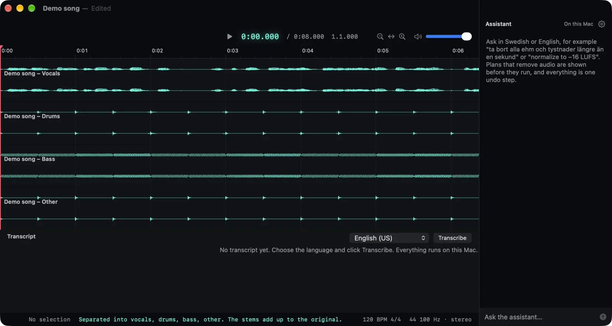

# Stems

**Audio › Separate Stems** splits a music track into four: **vocals, drums, bass** and **other**. Use it to turn the music down under speech, take a voice out of a song, or rebalance a mix you only have as one file.

## What happens

Each track with audio is replaced by four tracks, named after it ("Song – Vocals" and so on), that play from new files. They belong to one group, and together they sound **exactly** like the track did: Jämmer checks that the four add up to the original. So nothing changes until you change a stem: mute it, change its gain, cut it, or put a plugin on it. It's one undo step, and the original file is never touched. A transcript and speakers stay with the Vocals track.

## Good to know

- The model (Spleeter's 4-stem model from Deezer, MIT licence, 146 MB) is an optional download under **Jämmer › Settings… › Models**. It runs on your Mac.
- The model was trained on audio up to 11 kHz. Everything above that, and whatever the model doesn't assign, goes to **Other**, so nothing is lost; the stems just aren't separated up there.
- Separation is never perfect: expect some of the other instruments in each stem, most audibly in drums. Small changes (a few dB) sound natural; a fully solo stem will have artefacts.
- Tracks with plugins are refused; remove the plugins first and put them on the stems afterwards.
- The model works at 44.1 kHz stereo. Other projects are converted on the way in and out, which is inaudible but means the stems add up to the original to within that conversion rather than bit for bit.

## For agents

`POST …/separate` runs it as a job; `set_track` and `set_group` change one stem or all of them together. See [the guide](../agents.md#stems).
