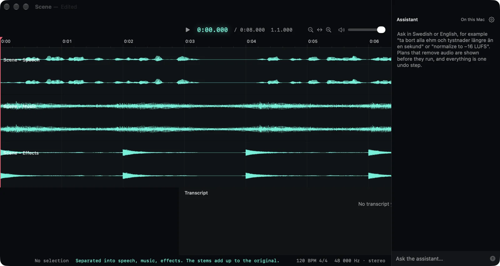

# Stems

**Audio › Separate Stems** splits a finished mix into its parts, in one of two ways:

- **Vocals, Drums, Bass, Other (music)**: for songs. Take a voice out, or rebalance a mix you only have as one file.
- **Speech, Music, Effects (soundtrack)**: for film and video sound. Turn the music down under the dialogue, or lift the speech out of a noisy scene.

## What happens

Each track with audio is replaced by four tracks, named after it ("Song – Vocals" and so on), that play from new files. They belong to one group, and together they sound **exactly** like the track did: Jämmer checks that the four add up to the original. So nothing changes until you change a stem: mute it, change its gain, cut it, or put a plugin on it. It's one undo step, and the original file is never touched. A transcript and speakers stay with the Vocals track.

## Good to know

- Both models are optional downloads under **Jämmer › Settings… › Models** and run on your Mac: Spleeter's 4-stem model from Deezer for music (MIT, 146 MB) and MERL's MRX for soundtracks (MIT, 122 MB).
- The music model was trained on audio up to 11 kHz. Everything above that, and whatever the model doesn't assign, goes to **Other**, so nothing is lost; the stems just aren't separated up there. With the soundtrack model, what it leaves is shared between Music and Effects, and Speech is kept as the model found it.
- The soundtrack model is slower (it reads the sound forwards and backwards) and works through long recordings in overlapping pieces.
- Separation is never perfect: expect some of the other instruments in each stem, most audibly in drums. Small changes (a few dB) sound natural; a fully solo stem will have artefacts.
- Tracks with plugins are refused; remove the plugins first and put them on the stems afterwards.
- The models work at 44.1 kHz stereo. Other projects are converted on the way in and out; what the conversion can't carry stays in the last stem, so the stems still add up to the original.

## For agents

`POST …/separate` runs it as a job; `set_track` and `set_group` change one stem or all of them together. See [the guide](../agents.md#stems).
