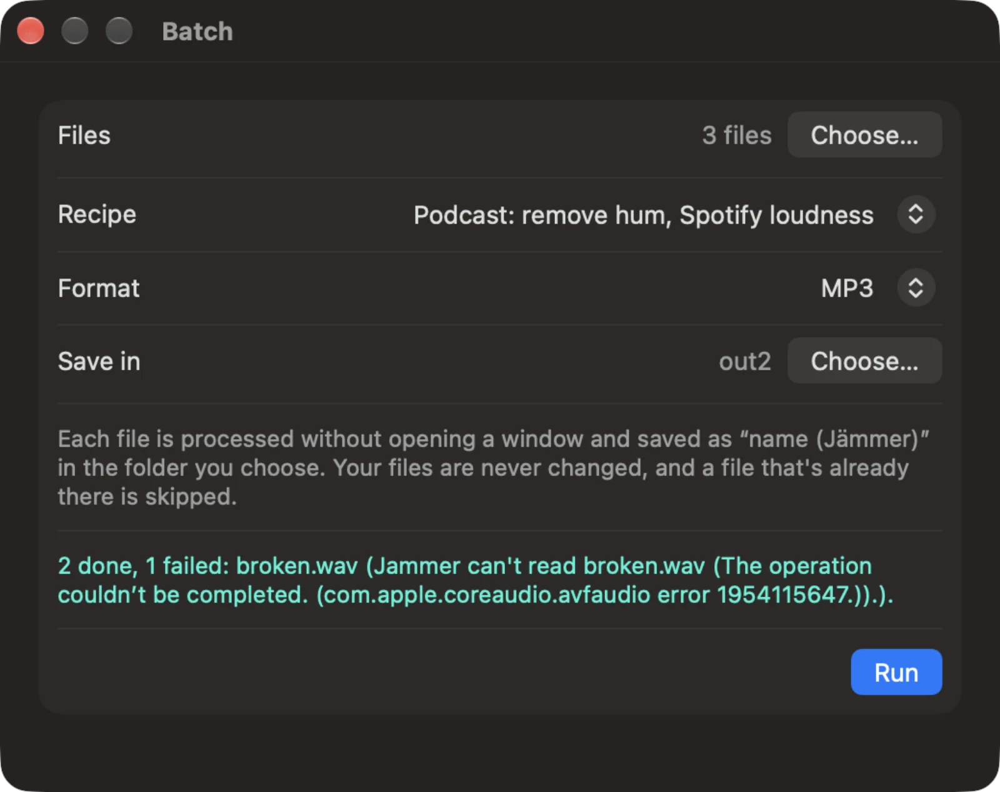

# Batch

**File › Batch…** (⌥⌘B) does the same thing to many files without opening them: clean up a season of episodes, bring a folder of clips to one loudness, or convert recordings to MP3.

## Run one



1. **Files**: choose audio files, or folders of them.
2. **Recipe**: what to do with each file. Jämmer comes with a few (remove hum and set Spotify loudness; Apple Podcasts or EBU R 128 loudness; reduce noise and normalize; convert only).
3. **Format**: what to save as (WAV, AIFF, FLAC, ALAC, AAC, Opus or MP3). Markers in a file become chapters where the format has them.
4. **Save in**: the folder the results go in.
5. **Run.**

Each file is saved as "name (Jämmer)" in that folder. Your files are never changed. A result that's already there is skipped, so you can run the same batch again after adding files. If one file can't be read or a step fails on it, the others still finish, and the window says which failed and why. If a loudness recipe couldn't reach its target on some file because of its peaks (the recipes use one gain and no limiter), the window lists those files with the level they did reach. MP3, AAC and Opus files are read back after encoding and corrected so that the file itself meets a loudness recipe's target, not just the mix it was made from (see [Exporting](06-exporting.md)); agents get each file's loudness as written and how much was added.

## Your own recipes

A recipe is a small JSON file in `~/Library/Application Support/Jammer/Recipes`, with the same steps and jobs the agent API takes; its file name is the recipe's name. For example `Interview.json`:

```json
{
  "jobs": [{"op": "restore", "params": {"kind": "denoise", "amount": 0.5}}],
  "steps": [{"op": "loudness_preset", "params": {"preset": "apple_podcasts"}}]
}
```

`jobs` can be `restore`, `transcribe`, `diarize` and `separate`; `steps` are the editing commands (see [the guide](../agents.md#operations)).

A batch run by an agent can also write the files at another sample rate than their own, with `"sampleRate"` in `"export"` (for example `{"format": "mp3", "bitRate": 192000, "sampleRate": 44100}`); the recipes in the window keep each file's own rate.

## Agents and folders

An agent can run batches too, but only inside folders you've allowed: **Jämmer › Settings… › Agents › Folders agents may use**. The list starts empty, so until you add a folder an agent can't read or write any file by its path. See [Agents](07-agents.md).
