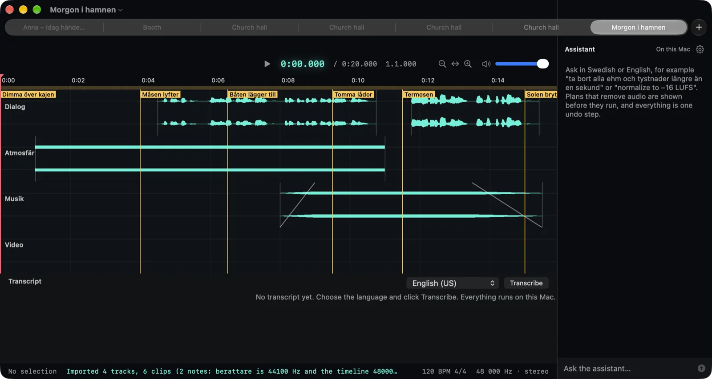

# Film timelines

**File › Import Timeline…** opens the sound of a film timeline as a new Jämmer document, so you can clean, level and mix a film's audio with everything Jämmer has. It reads FCPXML, the format Flimmer exports and that Final Cut Pro and DaVinci Resolve also write, and three more formats (see [Other timeline formats](#other-timeline-formats) below).

## What you get

- **One track for each audio lane** of the timeline, in the same order, named after the track (from Flimmer) or the audio role.
- **Each clip where it was**, with its trim, its level and its fades. Fades come in as straight (linear) fades, as film editors draw them.
- **Track level and mute.** A muted track stays muted.
- **The sound of the video clips themselves** on a track called **Video**, under the picture it belongs to.
- **A marker for each picture** (shot), with its name, so you can see what the sound sits under. These shot markers are never chapters: they don't end up in an exported MP3 or M4A. In an exported WAV they are written as cue points labeled "Shot: " and the name, so another program can tell them from your own markers.

The picture itself isn't shown.

**What it has been tried with:** Flimmer's exports, and FCPXML files written by hand to the format's rules. It has not yet been tried with files that Final Cut Pro or DaVinci Resolve wrote, so expect rough edges there, and check the result against the original.

Files from Flimmer carry exact times and separate levels for clips and tracks, and Jämmer uses those. From other programs the times are whole picture frames and a clip's level is all on the clip.

## Things to know

- **Nothing is changed in the film project or its files.** The document is new and untitled; save it as a Jämmer project.
- **The media has to be where the file says.** Export from Flimmer with the media packaged beside the file. A clip whose file is missing is left out, and the status bar says so.
- **Mixed sample rates.** The document takes the timeline's sample rate. A file recorded at another rate plays from a converted copy that Jämmer keeps with its own media; the original stays as it was.
- **A clip that is switched off** in a lane where others are on is left out (Jämmer mutes tracks, not single clips). If every clip in a lane is off, the track comes in muted.
- **Clips that overlap** on one lane are spread over an extra track beside it.

The status bar tells you how many tracks and clips came in and the first of any notes.

## Sending the sound back to Flimmer

When a film came from Flimmer, **File › Send to Flimmer…** sends the sound back to the same project. Flimmer has to be running with that project open.

1. Choose **What to send**: **Each changed clip as a new take**, or **The whole mix as one clip**.
2. Click **Check with Flimmer**. Jämmer prepares the files and asks Flimmer what it would do, without changing anything there. The sheet lists it: which clips become new takes, which new clips and tracks appear, and anything that won't sit under its picture any more.
3. Click **Send**.

Nothing is overwritten in Flimmer. A changed clip becomes a new take, and the original is muted and kept. One undo step in Flimmer takes the whole send back.

- **Transcripts.** With **Send each clip's transcript too**, each clip's transcript goes after its sound. A transcript that someone corrected by hand in Flimmer is replaced only if you tick **Replace transcripts corrected by hand in Flimmer**. The sheet says which transcripts went, and Flimmer's own words for any that didn't.
- **Send Transcripts Only** sends the transcripts again, to the clips this document sent before, without sending the sound. It needs Flimmer to have the same project open, and the sheet says why when it can't.
- **Canceling.** **Cancel** while the files are being prepared removes them from Flimmer again. Cancel after **Send** cancels Flimmer's job, and Flimmer takes back whatever it had begun. If Flimmer had already finished, the status bar says so: the change is made there, and you undo it in Flimmer with ⌘Z.
- **Speech made with a cloned voice** keeps its mark both ways. A clip whose file says it contains such speech (Flimmer marks it, and so does Jämmer's Overdub) shows **Cloned voice** on its track, and every file Jämmer sends to Flimmer or exports with any of that sound says so too, after cuts, mixes and repairs. The mark can't be removed.
- **The document remembers** which take each clip became in Flimmer and in which project. That is kept in the document and sent nowhere.

**What it has been tried with:** Flimmer's own test copy, in three live runs on 2026-11-18 and 2026-11-19: takes and new clips, a 10-minute line sent in parts, transcripts sent and sent again, corrected transcripts kept and replaced, and sends canceled while preparing and while Flimmer's job ran.

## Other timeline formats

**File › Import Timeline…** also reads these, and **File › Export Timeline…** writes them, so a document's clips can go to another program and come back. Nothing is rendered on export: the file names the audio files your clips play, where they are on your Mac.

- **CMX 3600 EDL** (.edl), the edit decision list most editing programs read and write. On import Jämmer asks what frame rate the times are at, since the list doesn't say. A list marked drop-frame starts at 29.97 drop-frame. Audio channels A to A4 become tracks 1 to 4. Each event's file is the one named in its SOURCE FILE, FROM FILE or FROM CLIP comment, or else a file named like the clip or the reel beside the list. Video and black events are left out, and a dissolve comes in as a cut. On export, the times are in the document's timecode, or 25 frames a second from 00:00:00:00 if it has none. An EDL holds four audio tracks and 999 events, and has no levels, fades or markers. The status bar says what was left behind.
- **OpenTimelineIO** (.otio), the open format from the Academy Software Foundation. The audio tracks are read, with their gaps; video tracks are left out and transitions come in as cuts. Times are written at the document's sample rate, so they come back exact. A clip's gain and fades and a track's level and mute are written in Jämmer's own metadata, so Jämmer reads them back; other programs ignore them.
- **DAWproject** (.dawproject), the open project format Bitwig published. Audio clips are read with their times (in seconds or in beats at the project's first tempo), fades, track volume and mute. Audio stored inside the project is unpacked into Jämmer's own media folder. Warped (time-stretched) clips, note clips and clips holding other clips are left out, and the status bar says so. On export each track gets its channel with level, pan and mute. The audio is referenced by its path, not copied in. A clip's own gain has no place in the format.

**What these have been tried with:** files Jämmer wrote and read back, and files written by hand to each format's published rules: an EDL as Premiere and Avid write it, OTIO in its older and newer forms, and a DAWproject in beats with audio packed inside. They have not yet been tried with files from Avid, Premiere, DaVinci Resolve, Bitwig or other programs, so check the result against the original.

## Agents

An agent can do the same with `POST /api/v1/import/fcpxml`, or `POST /api/v1/import/timeline` for any of the formats, with `rate` for an EDL. It works only for a file in a folder you've allowed under **Jämmer › Settings… › Agents**, and only if the media it uses is in an allowed folder too. `POST …/documents/{id}/export/timeline` with `format` (`edl`, `otio` or `dawproject`) answers with the file, and with what the format couldn't hold in an `X-Jammer-Warning` header. See [Agents](07-agents.md).
