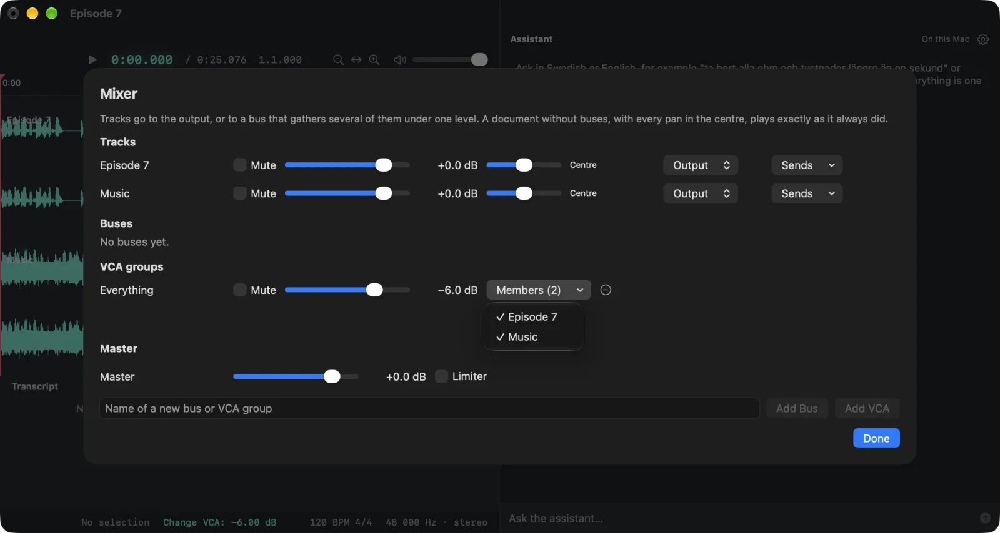

# Mixer

**Audio › Mixer…** (⌥⌘X) shows every track as a strip: mute, level, pan, and where it goes. Use it to set the balance between tracks, to place a track to the left or the right, and to gather tracks on a bus.

## Level, pan and mute

- **Level** is the track's gain, from −60 to +12 dB on the slider. Let go of the slider and the change is made; one drag is one undo step.
- **Pan** places a track between left and right in a stereo document. In the centre the track is left exactly as it is. Towards one side, that side stays as it is and the other falls away, so panning never makes anything louder and can't clip. A mono document has no pan.
- **Mute** silences the strip. A muted track is left out of exports too.

## Buses

A bus gathers several tracks under one level, one pan and one mute: all the music under one fader, all the guests under another.

1. Type a name at the bottom of the sheet and click **Add Bus**.
2. On each track that should go through it, choose the bus under the track's output (where it says **Output**).
3. Set the bus's own level, pan and mute on its strip.

A bus can itself go to another bus. Jämmer won't let buses be sent round in a circle; the buses that would close a circle aren't offered. The minus button takes a bus away; what went to it then goes where the bus went.

A document can have up to 64 buses.

## Sends

A send is a copy of a track (or of a bus) that goes to a bus as well, at a level of its own: a little of every voice to a bus with a reverb on it, or a copy of the drums to a bus that is squashed hard and mixed in underneath.

On a strip, open **Sends**, choose the bus, and pick a level. The same menu changes the level, takes the copy **before the fader**, or removes the send.

- **After the fader** (the usual way) the copy follows the strip: turn the track down, or pan it, and what it sends goes with it.
- **Before the fader** the copy keeps its own level whatever the fader does, and isn't panned. That is the one for a headphone mix that shouldn't change when you change the main mix.
- A muted strip sends nothing.
- A strip can have 16 sends. A bus can't be sent, directly or through other buses, back into itself; the buses that would do that aren't offered.
- Taking a bus away takes the sends to it away as well.

## Plugins on a bus

A bus can hold plugins, like a track: one compressor for all the voices, or a reverb on a bus that the tracks send to. In **Audio › Plugins…** the list at the top has the buses after the tracks, marked "(bus)"; choose one and add the plugin. It runs on everything that arrives at the bus, before the bus's level and pan.

**Timing.** A plugin with look-ahead makes its bus late. Jämmer delays every other path by as much wherever sounds meet, sends included, and starts that much earlier, so what you hear and what you export is in time, to the sample. Bypassing the plugin or taking it away takes the delay away too. A plugin that is late without saying so to Jämmer can't be made up for; if a bus sounds late with one plugin and not without it, that is the reason.

What this costs the computer depends on the plugins, not on the buses. It has not been measured well enough yet for the manual to give a number of tracks or plugins.

## VCA groups

A VCA group moves several tracks and buses together without anything being routed through it. Type a name at the bottom of the mixer and choose **Add VCA**, then tick the strips in the group's **Members** menu.

- The group's **level** is added to each member's own, and its **Mute** mutes them all. Each member keeps its own level, its plugins and where it goes, so the balance inside the group stays.
- A strip in the mixer shows its own level; what you hear is that plus the group's.
- A strip is in one group at most. Ticking it in another group moves it there. Unticking it takes the group's level off it.
- A send taken **before the fader** doesn't follow the group, just as it doesn't follow the fader.
- Removing a group (the − on its row) leaves the sound as it was: the group's level goes into each member's own level, and the members of a muted group stay muted.

When to use which: a **bus** when the tracks should share a plugin or be one thing on the way out; a **VCA group** when they should only move together.

## The master

Everything goes through the master last. At the bottom of the mixer it has a level, and a **Limiter** box.

- **The level** is one gain on the whole mix.
- **The limiter** holds the true peak of everything under the ceiling you set (−1 dBTP to begin with). It comes after everything else: every track, every bus, every plugin, and the master's own level. So turning the master up pushes into the limiter, not past it.
- **What it promises, and for what.** When you export, Jämmer measures the file it wrote and, if a peak is over the ceiling, writes it again with the limiter aiming a little lower, until the file holds. That covers what happens after the limiter too: another sample rate, 16 bits, and MP3 or AAC, whose encoders raise peaks (in a trial an MP3 needed 0.2 dB of margin and an AAC 0.8). If the file can't be held under the ceiling, the export fails and says what the file measured; lower the master's level or raise the ceiling. Playback has only one pass: it aims 0.1 dB under the ceiling and can go a little over. The promise is for exported files.
- Plugins go on the master like on a bus: in **Audio › Plugins…**, choose **Master** in the list.
- **Audio › Limit Peaks…** is another tool: it changes the tracks' own sound once, before plugins. The master's limiter changes nothing in the tracks and can be switched off again.

## What stays the same

- A document without buses, with every pan in the centre, plays and exports exactly as it did before there was a mixer, sample for sample.
- Repairs, echo, ducking and the limiter work on a track's own sound; its pan and its bus apply afterwards, as they do to everything the track plays.
- The limiter (**Audio › Limit Peaks…**) listens to the mix as the buses make it, without the plugins: they come after it, on tracks and on buses, and Jämmer says so when there are any.

## Projects and older versions

A project that uses the mixer (a bus, a pan, a track sent to a bus) is saved in a newer project format. A Jämmer from before the mixer says that the project needs a newer Jämmer, instead of opening it and playing every track straight out. A project that doesn't use the mixer is saved as it always was and opens anywhere.

## Agents

An agent sees the mixer with `GET /api/v1/documents/{id}/mixer` and changes it with the steps `add_bus`, `set_bus`, `remove_bus`, `set_send`, `add_vca`, `set_vca`, `remove_vca`, `set_master` and `set_track` (`pan`, `output`), and puts a plugin on a bus with `add_insert` and the bus's id; the mixer answers each strip's `latencySamples` and `compensationSamples`; see [the guide](../agents.md#operations). The assistant can add a bus, and change or remove one you name ("set the Music bus to −6 dB"); for pan, routing and sends, use the sheet.

An export through the master's limiter answers what the file measured in the `X-Jammer-Master-Limiter` header, or fails with `ceiling_not_met`.

Not there yet: solo, sidechain keys and freezing.
