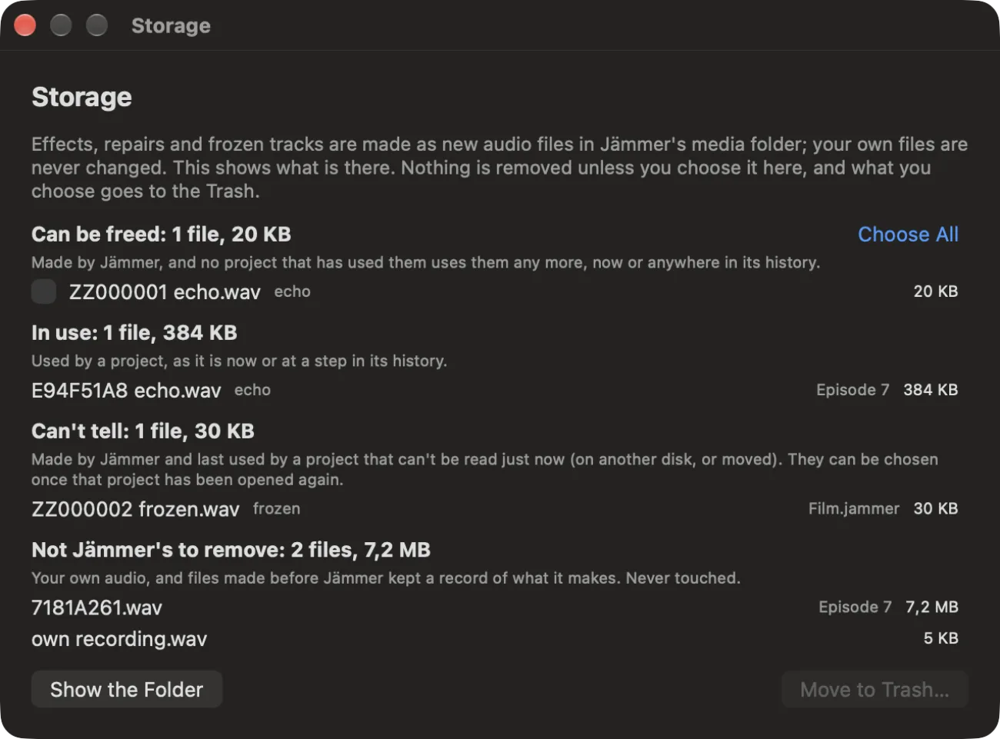

# Storage

Jämmer never changes your audio files. An effect, a repair or a frozen track is made as a new audio file, in Jämmer's media folder (`~/Library/Application Support/Jammer/Media`). Over time those files take room. **File › Storage…** shows what is there, and lets you move what is no longer needed to the Trash.

Nothing is ever removed by itself, and nothing is deleted: what you choose is moved to the Trash, where it stays until you empty it.

## The four groups

- **Can be freed.** Files Jämmer made, that no project which has used them uses any more: not as the project is now, and not at any step in its history, on any branch. These have a checkbox.
- **In use.** Files a project uses, now or at a step you could go back to. The project's name is beside each.
- **Can't tell.** Files Jämmer made that were last used by a project Jämmer can't read just now, for example one on a disk that isn't connected. A project that isn't here is not gone, so these can't be chosen. Open that project again and they sort themselves into one of the other groups.
- **Not Jämmer's to remove.** Your own audio (imported or recorded), and files Jämmer made before it began keeping a record of what it makes. These are never touched, whatever they are. Their size is shown so you can see what takes room; **Show the Folder** opens the folder if you want to deal with them yourself.

## Moving files to the Trash

Tick the files (or **Choose All**), then **Move to Trash…**. Jämmer says how many files and how much room, and that they stay in the Trash until you empty it. Afterwards the window says that nothing was deleted.

If a project later needs a file that was moved, the missing-file warning in its window says that the file was moved to the Trash from Storage, and when. Put it back from the Trash and open the project again.

## What Jämmer goes by

Jämmer keeps a record, in the media folder, of every file it makes there and of which projects have used it. Only a file in that record can ever be offered. If the record is missing or can't be read, nothing can be chosen.

A project counts as known when it is open, in **Open Recent**, autosaved, or has been seen using one of the files. An untitled document that you closed without saving is gone, and what only it used can be freed.

## Agents

An agent can read the same information with `GET /api/v1/storage`. There is no way for an agent to remove anything.
